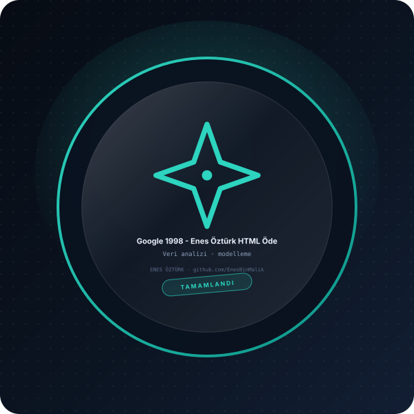

# Google 1998 - Enes Öztürk HTML Ödevi



> **Veri analizi · modelleme** — tasarım ve geliştirme: **Enes Öztürk**

---

Google'ın 1998 yılındaki ilk web sürümünün (Wayback Machine) Enes Öztürk imzalı birebir nostaljik tasarımı ve HTML ödev sunumu.

## Öne çıkanlar

- Veri temizleme ve hazırlık
- İstatistiksel özet ve görselleştirme
- Modelleme ve tahmin adımları
- Yönetici özeti ve rapor görünümü

## Kurulum ve çalıştırma

```bash
npm install
npm run dev        # http://localhost:3000
```

| Komut | Not |
| --- | --- |
| `npm install` | bağımlılıklar |
| `npm run dev` | geliştirme sunucusu |
| `npm run build` | üretim derlemesi |

## Proje yapısı

```
├── index.html
├── package.json
├── docs/rozet.svg        # imza rozeti
└── src/                  # uygulama kaynakları
```

## Lisans

Bu proje **Enes Öztürk** tarafından geliştirilmiştir; tüm hakları saklıdır.
